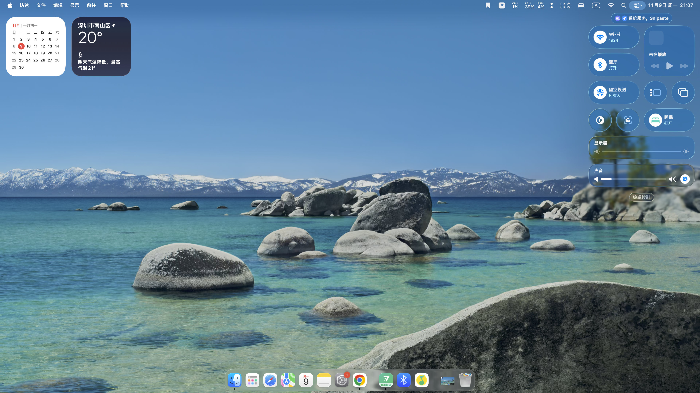

# XeMac

English | [简体中文](README.zh-CN.md)

macOS Tahoe 26.7.2 · OpenCore 1.0.6 · Arrow Lake Xe-LPG

An experimental macOS port for the **Intel Core Ultra 7 265K / Z890M AORUS ELITE WIFI7**, using integrated graphics and the motherboard’s DisplayPort output. The graphics stack builds on [ArrowWhatever](https://github.com/Mountainatic/ArrowWhatever) and [WTLIntelGfx](https://github.com/watchthelight-labs/WTLIntelGfx). Local changes cover desktop DisplayPort, HiDPI, Metal compositing, and Realtek Wi-Fi and Bluetooth compatibility.

This repository provides patches, selected source snapshots, pinned dependency versions, and validation summaries for building and porting the stack. Compatibility is limited to the tested platform and the feature coverage documented below.

Latest adaptation snapshot: **2026-11-11 / `a2bf4d4`**. [Bounded boot recovery](archive/boot/recovery-20261111/README.md) adds durable failure tracking and fresh same-boot HiDPI checks. One new native 4K60/2× HiDPI boot and next-boot commit passed; intermittent desktop-transition interruptions remain under investigation. The tested picker waits five seconds and defaults to Tahoe.

[Desktop preview](#desktop-preview) · [Compatibility](#features-and-compatibility) · [Implementation](#implementation) · [Build](#building-and-porting) · [Documentation](#documentation)

## Desktop preview



**3840×2160 @ 60 Hz · 1920×1080 logical resolution · 2× HiDPI**

Liquid Glass effects render in Control Center and the Dock. Display modes were checked through runtime queries; the Metal path was tested with compute, rendering, and texture probes.

## Test platform

| Component | Configuration |
| --- | --- |
| CPU | Intel Core Ultra 7 265K |
| Motherboard | Gigabyte Z890M AORUS ELITE WIFI7 |
| Integrated GPU | Intel Arrow Lake Xe-LPG, PCI `8086:7D67` |
| Display connection | Motherboard DisplayPort, one SST display |
| Wi-Fi / Bluetooth | Realtek, PCI `10EC:8922` / USB `0BDA:8922` |
| Operating system | macOS Tahoe 26.7.2, build `25G332` |
| OpenCore / SMBIOS | `1.0.6` / `MacPro7,1` |

Platform-specific port mapping and porting requirements are covered in the [platform notes](docs/HARDWARE.md).

## Features and compatibility

| Feature | Status | Test coverage |
| --- | --- | --- |
| DisplayPort | Validated | One SST display, native 3840×2160 @ 60 Hz |
| HiDPI | Validated | 1920×1080 logical resolution, 2× scaling |
| Metal desktop compositing | Validated | Compute, rendering, texture aliasing, and the WindowServer compositing path |
| Liquid Glass | Validated | Transparency, blur, and Liquid Glass effects in Control Center and the Dock |
| Wi-Fi | Basic connectivity available | d3: scanning, association, DHCP, and HTTPS; throughput and retransmission issues remain |
| Bluetooth | Basic functionality available | Controller activation, pairing, and speaker connection; extended playback and microphone use remain untested |
| CPU temperature | Readings available | Unmodified official SMCProcessor 1.3.7; accuracy and sustained-load comparisons remain untested |
| Hardware video decoding | Currently unavailable | No hardware decoding capability reported for the queried formats |
| Sleep / wake | Unvalidated | System testing incomplete |
| AirDrop / AWDL | Unvalidated | Dedicated feature testing incomplete |
| HDMI / USB-C / multiple displays / HDR | Unvalidated | Outside the tested display path |

Transient artifacts during login, delayed initial icon loading, and Metal compatibility issues in some applications remain under investigation. See [validation](docs/VALIDATION.md) for methods and limitations, and [known issues](docs/KNOWN-ISSUES.md) for the current issue list.

## Implementation

### DisplayPort and HiDPI

The desktop display path selects the external DP port using VBT, AUX, and EDID data, with support for display-v14 F/G/H port mapping. It allocates the framebuffer for the selected mode, exposes HiDPI modes, and publishes the current native timing to AGDC.

The validated path is DP-H / AUX `0x80` / TC3 / pipe A at 4K60. Mode validation checks physical pixels, logical dimensions, refresh rate, and the HiDPI flag together.

### Metal and desktop compositing

Local changes enable framebuffer fetch in the WindowServer path, track the actual memory type of buffers, and correct RGBA16Float texture aliasing. Tests cover pooled and standalone allocations, GPU clears, CPU visibility, and desktop compositing.

The graphics stack includes XeGfx, Display, Accel, AGDC, XeMTL, Mesa ANV, and libdrm. The core and plugin use different source revisions; patches and user-space dependencies must be matched per component.

| Patch | Main changes |
| --- | --- |
| `0038`, `0041` | External DP, AUX mapping, EDID modes, and HiDPI |
| `0039` | Cross-host KPI source and build checks |
| `0042`, `0044` | WindowServer framebuffer fetch, buffer memory types, and texture aliasing |
| `0045` | Publication of the current native display timing to AGDC |

Patches `0001` through `0037` originate from ArrowWhatever. Local patches and component relationships are documented in the [graphics notes](docs/GRAPHICS.md) and [build guide](docs/BUILD.md).

### Realtek Wi-Fi and Bluetooth

Wi-Fi is based on AirportRTW V2.3.1. The d3 changes fix a missing unlock in the completion timeout path and move IRQ/C2H processing to a dedicated workloop, addressing a mutual wait during firmware power-up. d3 is the current configuration; the d4 receive queue and d5 BA/PMF diagnostics remain experimental branches.

Bluetooth is based on RealtekBluetoothFirmware and BrcmPatchRAM. Local changes address the target controller name, EMP2 initialization, and scan error 718. The validated combination is RealtekBluetoothFirmware `1.0.2d1` with BlueToolFixup `2.7.2d2`; patch matching is restricted to `25G332 / x86_64 / 0BDA:8922`.

Source revisions, patch order, and limitations are documented in the [Wi-Fi](docs/WIRELESS.md) and [Bluetooth](docs/BLUETOOTH.md) guides.

## Component versions

| Component | Validated version |
| --- | --- |
| XeGfx / XeGfxDisplay | `0.0.44` / `0.5.45` |
| XeGfxAccel / XeGfxAGDC | `0.1` / `0.1` |
| WTLArrowEarlyClaim / XeMTLDriver | `1.2` / `0.35.44` |
| AirportRTW local branch | `2.3.1d3` |
| RealtekBluetoothFirmware / BlueToolFixup | `1.0.2d1` / `2.7.2d2` |
| SMCProcessor | Official `1.3.7`, unmodified |

See the [build guide](docs/BUILD.md) for complete source revisions and dependency versions.

## Building and porting

1. Check device IDs, the display path, and the OS build against the [platform notes](docs/HARDWARE.md).
2. Follow the [build guide](docs/BUILD.md) to obtain pinned upstream sources, apply patches per component, and prepare firmware, SDKs, and runtime libraries.
3. Use the [porting guide](docs/INSTALLATION.md) to prepare the target system’s ACPI, USB mapping, SMBIOS, and driver dependencies.
4. Follow the [validation guide](docs/VALIDATION.md) to check display modes, Metal, wireless connectivity, and sensors.

The repository contains patches, selected source snapshots, and reference tools. A complete EFI, installer, firmware, and third-party build artifacts must be prepared separately. See the build guide for the status of full-stack builds from a clean environment.

Run the repository checks with Python 3.9 or newer:

```sh
python3 tools/verify-repository.py
```

Checks cover file formats, source and script syntax, and relative documentation links. After committing, add `--git` to compare working-tree files with committed bytes.

## Documentation

The detailed guides below are currently in Chinese.

| Document | Contents |
| --- | --- |
| [Platform](docs/HARDWARE.md) | Device matching, display topology, and compatibility scope |
| [Build guide](docs/BUILD.md) | Pinned revisions, patch order, dependencies, and build scope |
| [Porting guide](docs/INSTALLATION.md) | Target environment and component deployment requirements |
| [Graphics](docs/GRAPHICS.md) | DP, HiDPI, Metal, and key patches |
| [Wi-Fi](docs/WIRELESS.md) / [Bluetooth](docs/BLUETOOTH.md) | Driver changes, branch status, and compatibility limits |
| [Validation](docs/VALIDATION.md) / [Known issues](docs/KNOWN-ISSUES.md) | Methods, results, and remaining work |
| [Change log](CHANGELOG.md) | Adaptation changes by component |
| [Upstream sources](docs/UPSTREAMS.md) | Project origins, pinned versions, and contribution scope |
| [Contributing](CONTRIBUTING.md) | Issue reports, patch format, and validation requirements |

Sources and patches are in `archive/`, patch replay results in `evidence/`, configuration examples in `examples/`, and repository tools in `tools/`.

## References and acknowledgments

| Project | Role |
| --- | --- |
| [ArrowWhatever](https://github.com/Mountainatic/ArrowWhatever) | Native display support, reference patches, and build work |
| [WTLIntelGfx](https://github.com/watchthelight-labs/WTLIntelGfx) / historical NvGfx | XeGfx core, display, accelerator, AGDC, and XeMTL |
| [AirportRTW](https://github.com/souissiak1-maker/AirportRTW) | Native Realtek Wi-Fi driver |
| [RealtekBluetoothFirmware](https://github.com/thegwchr/RealtekBluetoothFirmware) | Realtek Bluetooth firmware loading |
| [BrcmPatchRAM](https://github.com/acidanthera/BrcmPatchRAM) | BlueToolFixup and Bluetooth compatibility framework |
| [OpenCorePkg](https://github.com/acidanthera/OpenCorePkg) | Bootloader and configuration framework |
| [VirtualSMC](https://github.com/acidanthera/VirtualSMC) / [Lilu](https://github.com/acidanthera/Lilu) | Sensors and kernel extension infrastructure |

The graphics stack incorporates work from NullMoth Systems, Mesa ANV, libdrm, FreeBSD drm-kmod, Intel i915, metal2vulkan, and their contributors. Dependency origins and contribution scope are documented in [upstream sources](docs/UPSTREAMS.md). Copyright and Required Notices are preserved in [third-party notices](THIRD-PARTY-NOTICES.md).

## LLM collaboration

This repository was organized collaboratively by the maintainer and large language models (LLMs). LLM assistance included upstream source analysis, parts of the adaptation patches and scripts, test-result summaries, and documentation revisions.

Feature and compatibility statements are based on recorded build checks, patch replay, and hardware testing. See [validation](docs/VALIDATION.md) for the scope of those checks.

## License

Independently authored documentation and repository tools are licensed under MIT. Derived source files and patches retain their respective upstream licenses. Some graphics components use **PolyForm Noncommercial 1.0.0**, which restricts commercial use.

See [LICENSE](LICENSE) and [THIRD-PARTY-NOTICES.md](THIRD-PARTY-NOTICES.md) for the applicable terms. Redistribution must preserve the relevant copyright, license, and notice files.
