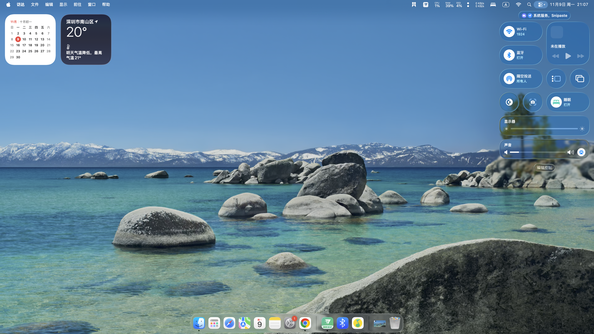

# XeMac

[English](README.md) | 简体中文

macOS Tahoe 26.7.2 · OpenCore 1.0.6 · Arrow Lake Xe-LPG

面向 **Core Ultra 7 265K / Z890M AORUS ELITE WIFI7** 的 macOS 适配，使用核显与主板 DisplayPort 输出。图形部分基于 [ArrowWhatever](https://github.com/Mountainatic/ArrowWhatever) 和 [WTLIntelGfx](https://github.com/watchthelight-labs/WTLIntelGfx)，本地修改覆盖桌面 DP、HiDPI、Metal 合成、Realtek Wi-Fi 及蓝牙兼容。

仓库收录适配补丁、关键源码、固定依赖与验证摘要，供同平台构建和移植。当前为实验性适配，兼容范围以测试平台和各项验证结果为准。

[实机展示](#实机展示) · [兼容性](#功能与兼容性) · [技术实现](#技术实现) · [构建](#构建与移植) · [文档](#文档)

## 实机展示



**3840×2160 @ 60 Hz · 1920×1080 逻辑分辨率 · 2× HiDPI**

控制中心与 Dock 的 Liquid Glass 液态玻璃效果已适配。显示模式通过运行时查询核对，Metal 路径通过计算、绘制及纹理探针验证。

## 测试平台

| 项目 | 配置 |
| --- | --- |
| 处理器 | Intel Core Ultra 7 265K |
| 主板 | Gigabyte Z890M AORUS ELITE WIFI7 |
| 核显 | Intel Arrow Lake Xe-LPG，PCI `8086:7D67` |
| 显示连接 | 主板 DisplayPort，单显示器 SST |
| Wi-Fi / 蓝牙 | Realtek，PCI `10EC:8922` / USB `0BDA:8922` |
| 系统 | macOS Tahoe 26.7.2，Build `25G332` |
| OpenCore / SMBIOS | `1.0.6` / `MacPro7,1` |

平台相关的端口映射与移植条件见 [平台说明](docs/HARDWARE.md)。

## 功能与兼容性

| 功能 | 状态 | 验证范围 |
| --- | --- | --- |
| DisplayPort | 已验证 | 单显示器 SST，原生 3840×2160 @ 60 Hz |
| HiDPI | 已验证 | 1920×1080 逻辑分辨率，2× 缩放 |
| Metal 桌面合成 | 已验证 | 计算、绘制、纹理别名及 WindowServer 合成路径 |
| Liquid Glass | 已验证 | 控制中心与 Dock 的透明、模糊和液态玻璃效果 |
| Wi-Fi | 基础联网可用 | d3：扫描、关联、DHCP、HTTPS；吞吐与重传待修复 |
| 蓝牙 | 基础功能可用 | 控制器开启、配对、音箱连接；长播及麦克风待测 |
| CPU 温度 | 可读取 | 官方 SMCProcessor 1.3.7；精度与持续负载对照待测 |
| 视频硬件解码 | 当前不可用 | 已查询格式未提供硬件解码能力 |
| 睡眠 / 唤醒 | 未验证 | 尚未完成系统测试 |
| AirDrop / AWDL | 未验证 | 尚未完成独立功能测试 |
| HDMI / USB-C / 多显示器 / HDR | 未验证 | 超出当前显示路径的测试范围 |

登录阶段短暂黑块、首次图标加载延迟及部分 App 的 Metal 兼容问题仍在跟踪。测试方法与限制见 [验证记录](docs/VALIDATION.md)，问题清单见 [已知问题](docs/KNOWN-ISSUES.md)。

## 技术实现

### DisplayPort 与 HiDPI

依据 VBT、AUX 和 EDID 选择桌面外接 DP，补充 display-v14 F/G/H 端口映射；按实际模式分配 framebuffer、生成 HiDPI 模式，并向 AGDC 发布当前原生时序。

已验证路径为 DP-H / AUX `0x80` / TC3 / pipe A，输出 4K60。模式验证同时检查物理像素、逻辑尺寸、刷新率与 HiDPI 标志。

### Metal 与桌面合成

在 WindowServer 路径补充 framebuffer fetch 支持，记录缓冲区实际内存类型，修正 RGBA16Float 纹理别名。验证覆盖池化与独立分配、GPU clear、CPU 可见性以及桌面合成。

图形栈由 XeGfx、Display、Accel、AGDC、XeMTL、Mesa ANV 与 libdrm 等组件组成。核心和 plugin 使用不同源码基点，构建时须按组件匹配补丁及用户态依赖。

| 补丁 | 主要修改 |
| --- | --- |
| `0038`、`0041` | 外接 DP、AUX 映射、EDID 模式与 HiDPI |
| `0039` | 跨宿主 KPI 源码及构建检查 |
| `0042`、`0044` | WindowServer framebuffer fetch、缓冲区类型及纹理别名 |
| `0045` | AGDC 当前原生模式时序发布 |

`0001` 至 `0037` 为 ArrowWhatever 参考补丁；本地补丁及组件关系见 [图形适配](docs/GRAPHICS.md) 和 [构建说明](docs/BUILD.md)。

### Realtek Wi-Fi 与蓝牙

Wi-Fi 基于 AirportRTW V2.3.1。d3 修复 completion 超时路径漏解锁，将 IRQ/C2H 处理移至独立 workloop，处理固件上电期间的相互等待。当前使用 d3；d4 接收队列与 d5 BA/PMF 诊断保留为实验分支。

蓝牙基于 RealtekBluetoothFirmware 与 BrcmPatchRAM，修改目标控制器名称、EMP2 初始化及扫描错误 718 的兼容路径。已验证组合为 `1.0.2d1` + `2.7.2d2`，补丁匹配范围限定于 `25G332 / x86_64 / 0BDA:8922`。

源码基点、补丁顺序及功能限制见 [Wi-Fi](docs/WIRELESS.md) 和 [蓝牙](docs/BLUETOOTH.md)。

## 组件版本

| 组件 | 已验证版本 |
| --- | --- |
| XeGfx / XeGfxDisplay | `0.0.44` / `0.5.45` |
| XeGfxAccel / XeGfxAGDC | `0.1` / `0.1` |
| WTLArrowEarlyClaim / XeMTLDriver | `1.2` / `0.35.44` |
| AirportRTW 本地分支 | `2.3.1d3` |
| RealtekBluetoothFirmware / BlueToolFixup | `1.0.2d1` / `2.7.2d2` |
| SMCProcessor | 官方 `1.3.7`，未修改 |

完整源码基点与依赖版本见 [构建说明](docs/BUILD.md)。

## 构建与移植

1. 核对 [平台说明](docs/HARDWARE.md) 中的设备 ID、显示路径与系统构建。
2. 按 [构建说明](docs/BUILD.md) 获取固定上游源码，分组件应用补丁并准备固件、SDK 与运行库。
3. 按 [移植准备](docs/INSTALLATION.md) 配置目标机器的 ACPI、USB 映射、SMBIOS 与驱动依赖。
4. 依照 [验证记录](docs/VALIDATION.md) 检查显示模式、Metal、无线和传感器功能。

仓库提供补丁、选定源码快照和参考工具。完整 EFI、安装器、固件及第三方构建产物需自行准备；图形整栈从空环境构建的验证状态见构建文档。

在仓库内运行文件检查，需要 Python 3.9 或更高版本：

```sh
python3 tools/verify-repository.py
```

检查范围包括文件格式、源码与脚本语法、文档相对链接。提交后可加 `--git` 核对工作区与提交字节。

## 文档

| 文档 | 内容 |
| --- | --- |
| [平台说明](docs/HARDWARE.md) | 设备匹配、显示拓扑与兼容范围 |
| [构建说明](docs/BUILD.md) | 固定基点、补丁顺序、依赖与构建范围 |
| [移植准备](docs/INSTALLATION.md) | 目标环境与组件部署要求 |
| [图形适配](docs/GRAPHICS.md) | DP、HiDPI、Metal 及关键补丁 |
| [Wi-Fi](docs/WIRELESS.md) / [蓝牙](docs/BLUETOOTH.md) | 驱动实现、分支状态与兼容限制 |
| [验证记录](docs/VALIDATION.md) / [已知问题](docs/KNOWN-ISSUES.md) | 验证方法、结果及未完成事项 |
| [修改记录](CHANGELOG.md) | 按组件整理的适配变更 |
| [上游说明](docs/UPSTREAMS.md) | 项目来源、固定版本与贡献范围 |
| [贡献指南](CONTRIBUTING.md) | 问题反馈、补丁格式与验证要求 |

源码与补丁位于 `archive/`，重放结果位于 `evidence/`，配置参考位于 `examples/`，仓库工具位于 `tools/`。

## 参考与致谢

| 项目 | 使用范围 |
| --- | --- |
| [ArrowWhatever](https://github.com/Mountainatic/ArrowWhatever) | 原生显示适配基础、参考补丁与构建工作 |
| [WTLIntelGfx](https://github.com/watchthelight-labs/WTLIntelGfx) / 历史 NvGfx | XeGfx 核心、显示、加速器、AGDC 与 XeMTL |
| [AirportRTW](https://github.com/souissiak1-maker/AirportRTW) | Realtek 原生 Wi-Fi 驱动 |
| [RealtekBluetoothFirmware](https://github.com/thegwchr/RealtekBluetoothFirmware) | Realtek 蓝牙固件加载 |
| [BrcmPatchRAM](https://github.com/acidanthera/BrcmPatchRAM) | BlueToolFixup 及蓝牙兼容框架 |
| [OpenCorePkg](https://github.com/acidanthera/OpenCorePkg) | 引导与配置框架 |
| [VirtualSMC](https://github.com/acidanthera/VirtualSMC) / [Lilu](https://github.com/acidanthera/Lilu) | 传感器与内核扩展基础 |

图形栈继承 NullMoth Systems、Mesa ANV、libdrm、FreeBSD drm-kmod、Intel i915 和 metal2vulkan 等项目的工作。依赖及贡献范围详见 [上游说明](docs/UPSTREAMS.md)；原版权与 Required Notice 见 [第三方告知](THIRD-PARTY-NOTICES.md)。

## LLM 协作

本仓库由维护者与大语言模型（LLM）协作整理。LLM 参与了上游源码分析、部分适配补丁与脚本编写、测试记录归纳及文档修订。

功能状态与兼容性结论依据已记录的构建检查、补丁重放和实机测试，具体覆盖范围见 [验证记录](docs/VALIDATION.md)。

## 许可

独立编写的文档与仓库工具采用 MIT。衍生源码与补丁遵循各组件原许可；部分图形组件采用 **PolyForm Noncommercial 1.0.0**，存在非商业使用限制。

授权范围见 [LICENSE](LICENSE) 和 [THIRD-PARTY-NOTICES.md](THIRD-PARTY-NOTICES.md)。再分发时须保留对应版权、许可和告知文件。
